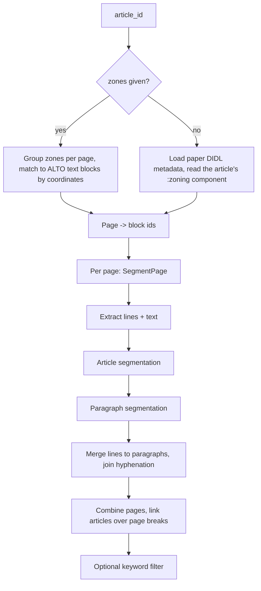

# How it works

## Pipeline

## 1. Selecting blocks (`RedefineArticle.get_article_zoning`)

- Without `zones`: the paper's DIDL (`https://resolver.kb.nl/resolve?urn=<paper id>`) is loaded
  (or read from `mpeg21_cache_dir`). The component `<article_id>:zoning` lists the article parts;
  for each part the page id and the ALTO `TextBlock` ids are read.
- With `zones`: each zone's `image` filename (`DDD_000022499_003_access.jp2`) gives the page
  (`ddd:000022499:mpeg21:p003`). `SegmentPage.zones_to_block_ids` matches the rounded
  `x, y, w, h` against the ALTO text block coordinates exactly; a zone without matching block
  raises `ValueError`. Empty dicts in the list are ignored.

Only lines in these blocks are used further. The page's ALTO is fetched via
`https://resolver.kb.nl/resolve?urn=<page id>:alto`, or read from `alto_cache_dir`.

## 2. Lines (`SegmentPage.get_text_lines_df`)

Each `TextLine` becomes a row with its coordinates (`hpos`, `vpos`, `width`, `height`), its block
(`block_id`, `block_hpos`, `block_width`) and the joined text of its `String` elements. Hyphenation
metadata (`hyppart1`, `hyppart2`, `hypcontent`, `hyphenated`) is kept. Optionally font and
paragraph styles (`keep_styles`).

Block flags are computed in ALTO order (`get_text_blocks_df`):

- `same_column`: horizontal overlap with the previous block >= 0.8 (relative to the narrowest
  of the two).
- `starts_right`: block starts at or right of the previous block.
- `logical_flow`: `same_column or starts_right`. A block that is not in logical flow (it jumps back
  to the left, e.g. a new column on the page start) begins a new article.

## 3. Article segmentation (`segment_articles`)

The rule is that a new article starts where the vertical white space between two lines is unusually
large compared to the other gaps.

1. Gap = `vpos` of the line minus the bottom of the previous line (`vpos + height`), per block, or
   across the whole page when `ignore_blocks=True` (negative gaps = jump to the next column, ignored
   in the statistics).
2. Gaps >= `article_gap_outlier_cutoff` (30 ALTO units) are outliers: they always start an article and
   are left out of the z-score so they do not mask smaller gaps.
3. A line starts an article if its gap z-score >= `article_split_threshold` **and** the gap is at least a third of the
   median line height of the group.
4. Without `ignore_blocks`: single-line blocks start an article (`article_single_line_split`);
   the first line of a block that is not in logical flow starts an article; the first line of a
   `same_column` block starts an article.
5. A line that is the second half of a hyphenated word (`hyppart2`) can never start an article.
6. Candidate starts are removed if the text clearly continues: the previous line does not end in
   `. ? !`, the current line does not begin with a capital, and the two line widths are within 1%.
7. One-line articles (usually headers) are merged with the next article
   (`merge_single_line_article_to_next`).

The ids are `A001`, `A002`, ... per page.

The z-score depends on the spacing distribution of the page, which is why the result is good in
older newspapers (uniform columns, headers with obvious spacing) and why a higher threshold may be
needed in modern layouts, at the cost of false splits. Advertisements break the assumptions
altogether.

## 4. Paragraph segmentation (`segment_paragraphs`)

Per block and article:

1. Indentation = (`hpos` of the line - minimal `hpos` in the group) / widest line width in the group.
2. Lines with indentation > 0.15 are outliers: they start a paragraph (e.g. large indents) and
   are excluded from the z-score.
3. Otherwise a line starts a paragraph if the z-score of its indentation >= `paragraph_split_threshold_z`
   **and** the indentation >= `paragraph_split_threshold_r`. The ratio guards against spurious starts when
   all indentation differences are tiny.
4. Second halves of hyphenated words never start a paragraph; single-line blocks always do
   (`paragraph_single_line_split`); blocks outside logical flow start a new paragraph.

The ids are `P001`, ... per page. Because only indentation is used, text without indented
paragraph starts is not split.

## 5. Merging (`merge_paragraphs`)

Lines are grouped by (`article_id`, `paragraph_id`) and joined with spaces. For hyphenated words the
end-of-line fragment (`hyppart1`) is replaced by the full word (`hypcontent`) and the fragment at
the start of the next line (`hyppart2`) is removed.

## 6. Combining pages (`get_page_paragraphs`, `assign_article_ids`)

Pages are processed one by one (their segmentation is independent) and concatenated. Article ids
are renumbered over the whole document (the page-local ids are kept in `page_article_id`).
The first paragraph of a page continues the last article and paragraph of the previous page when it
has id `P000`, which means no paragraph start was detected before the first text line on that page.
`merge_paragraphs_over_page_split` (used when keywords are given) joins these `P000` rows to the
previous paragraph.

## 7. Keyword filtering (`merge_split_articles`)

When `keywords` are given, paragraphs matching any keyword (case-insensitive) select their complete
article. Paragraphs between two hits are also kept when there are at most `max_paragraph_gap` of
them. A falsy `max_paragraph_gap` keeps everything from the first to the last hit.

## Zoning output

With `add_zoning=True`, `zoning_df` holds one bounding box per (block, article) group with the page
image filename. `zoning_to_dict()` returns this as a list of `{"x", "y", "w", "h", "image"}`
dicts, which can be passed back as `zones`.

## Visual checks

`plot_blocks(image, df, color_column=..., id_column=...)` draws the rectangles of `df`
(`hpos`, `vpos`, `width`, `height`) on the page scan, coloured per value of `color_column`.
`fetch_image(page_id, image_cache="image_cache")` downloads the page scan (cached as jpg).
